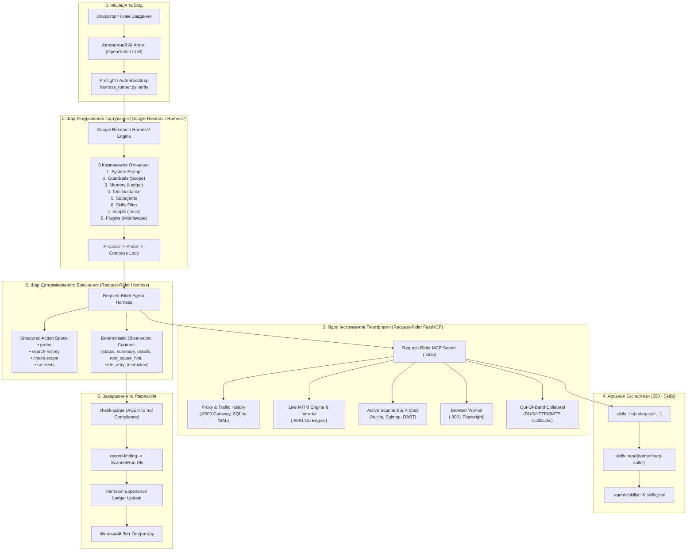
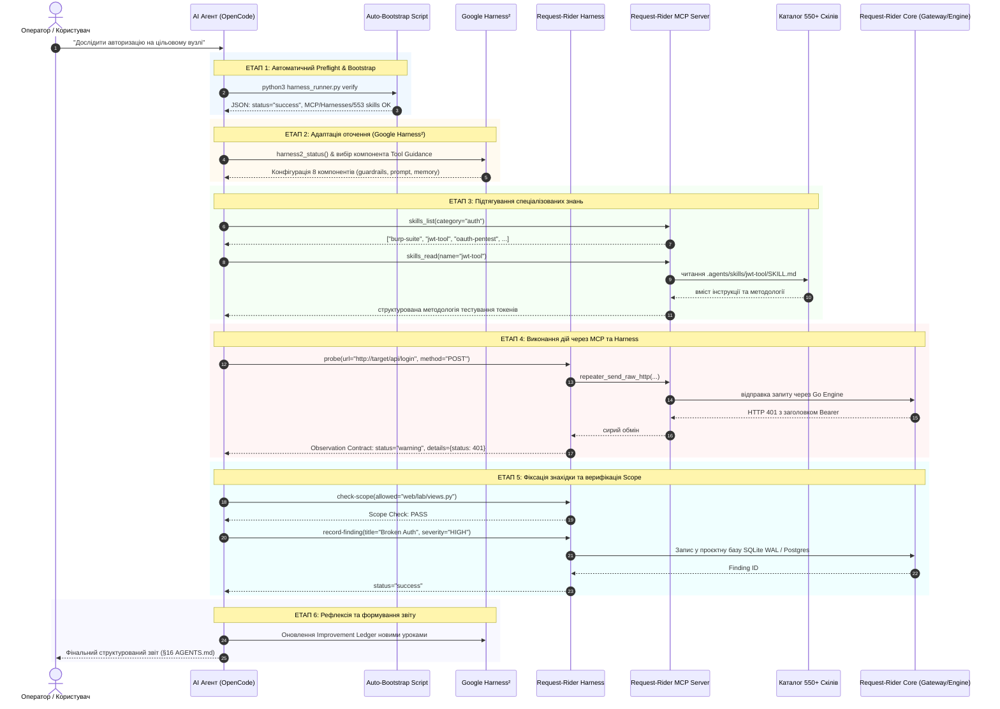

# Візуалізація та Архітектура Ланцюжка Взаємодії Агента в Request-Rider

Цей документ детально розкриває, як автономний агент (OpenCode, Codex, Claude Code, Antigravity) взаємодіє з інтегрованою екосистемою **Request-Rider**:
1. **Request-Rider MCP** (базове ядро інструментів платформи)
2. **Request-Rider Harness** (детермінований Action Space, Observation Contract, Scope Guard)
3. **Google Research Harness²** (рекурсивне Propose-Probe-Compose гартування та оптимізація оточення)
4. **Арсенал скілів** (553 структуровані інженерні методології)

---

## 1. Загальна Топологія та Потоки Даних

---

## 2. Sequence-Діаграма Повного Життєвого Циклу Завдання

---

## 3. Як Функціонує Кожен Компонент у Цілісному Ланцюжку

### 1. Ядро: Request-Rider MCP Server (`request-rider-mcp`)
- **Роль**: Головний фасад платформи. Надає агентському середовищу 97+ прямих безпекових та діагностичних методів:
  - Робота з HTTP/HTTPS перехопленим трафіком (`history_get_records`, `history_get_transaction_raw`).
  - Ручне надсилання та повторення запитів (`repeater_send_raw_http`).
  - Високошвидкісний фаззінг маркерів (`intruder_start_attack`).
  - Запуск вбудованих сканерів (`scanner_active_start`).
  - Розвідка та OSINT граф (`osint_run_transform`).
  - Out-of-band підтвердження вразливостей (`oob_generate`, `oob_poll`).
  - Керування навичками (`skills_list`, `skills_read`).

### 2. Детермінований Action Space: Request-Rider Harness
- **Роль**: Захист від хаотичного виконання неконтрольованих shell-команд.
- Забезпечує контракт **Observation Contract**:
  - `status`: `"success"` | `"warning"` | `"error"`
  - `summary`: стислий зміст результату в одне речення
  - `details`: технічні деталі (метрики, статус-код, час)
  - `root_cause_hint`: підказка щодо першопричини збою
  - `safe_retry_instruction`: безпечна дія для виправлення ситуації
  - `explicit_stop_condition`: критерій, за якого агент зобов'язаний зупинитися
- Контролює межі змін за допомогою `check-scope` (перевірка несанкціонованого редагування файлів).

### 3. Рекурсивне Гартування: Google Research Harness²
- **Роль**: Адаптивне налаштування оточення моделі для складних відкритих завдань.
- Керує 8 компонентами:
  1. `system_prompt` — контекстні системні директиви.
  2. `guardrails` — жорсткі інваріанти безпеки.
  3. `memory` — персистентний журнал успішних патернів (`Improvement Ledger`).
  4. `tool_guidance` — контекстні підказки щодо правильного виклику інструментів.
  5. `subagents` — делегування підзадач субагентам.
  6. `skills` — динамічна фільтрація релевантних навичок.
  7. `scripts` — автоматичні перевірочні скрипти.
  8. `plugins` — підключення додаткових обробників.
- Забезпечує цикл **Propose-Probe-Compose**: агент пропонує зміни в оточення, зондує їх вплив і компонує найефективніше робоче середовище.

### 4. Бібліотека Знань: 550+ Скілів (`.agents/skills/*`)
- **Роль**: Глибока інженерна база знань на всі випадки (від аудиту смарт-контрактів та Burp Suite до аналізу хмарної безпеки AWS/GCP).
- Агент не тримає всі 550 скілів у системному промпті (що призвело б до переповнення контексту), а шукає їх на вимогу через `skills_list` та зчитує лише потрібний `SKILL.md` через `skills_read`.

---

## 4. Стратегічні Точки Покращення Взаємодії (Optimization Roadmap)

| Точка ланцюжка | Поточний стан | Пропоноване покращення | Очікуваний ефект |
|---|---|---|---|
| **1. Вибір скіла (Skills Discovery)** | Агент шукає скіл за текстовим пошуком підрядка (`category`) | **Семантичний підбір скілів через індекс**: інтеграція локального роутера, що за запитом завдання повертає топ-3 найбільш релевантні скіли автоматично | Зменшення зайвих ітерацій пошуку з 2 кроків до 0 |
| **2. Скорочення навантаження на контекст (Observation Compression)** | Сирі дампи відповідей можуть перевищувати ліміти контексту | **Автоматичний Smart-Trimming**: стиснення HTML/JS відповідей до семантичних маркерів (форми, заголовки, параметри) | Економія до 70% контекстного вікна під час сканування |
| **3. Зворотний зв'язок з UI (UI Sync State)** | Агент фіксує результати в БД, а користувач бачить їх після ручного оновлення | **Live WebSocket Broadcast**: сповіщення UI про кожну знахідку або дію агента в реальному часі через Gateway WebSocket | Оператор миттєво бачить дії агента на живому дашборді |
| **4. Автоматична рефлексія Harness² (Auto-Reflection)** | Рефлексія запускається окремим викликом демо або свіпу | **Zero-overhead background reflection**: після фіксації знахідки або проходження тестів короткий дельта-урок автоматично записується в `harness2 improvement ledger` | Постійне самонавчання агента від завдання до завдання |
